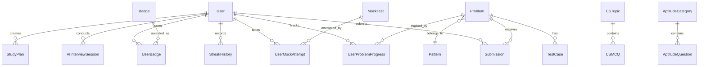

# Design Document: Placement Preparation Platform

## Overview

The Placement Preparation Platform is a comprehensive web-based learning system designed to help students prepare for technical placements through a multi-modal approach combining algorithmic practice, aptitude training, core computer science education, and AI-powered interview preparation.

### Core Design Principles

1. **Pattern-Based Learning**: Organizes DSA problems by problem-solving patterns rather than data structure categories, helping students recognize and apply approaches systematically.
2. **Spaced Repetition**: Implements the SM-2 algorithm to optimize long-term retention of problem-solving skills.
3. **Gamification**: Uses streaks, XP, levels, and leaderboards to maintain user engagement and motivation.
4. **Real-Time Feedback**: Provides immediate code execution results and AI-powered assistance.
5. **Comprehensive Coverage**: Integrates DSA, aptitude, core CS subjects, and interview practice in one platform.

### System Capabilities

- Real-time code execution in multiple languages (C++, Java, Python, JavaScript)
- Adaptive spaced repetition scheduling for problem revision
- AI-powered hints, code reviews, and mock interviews using Claude API
- Daily streak tracking with timezone awareness
- College-based competitive leaderboards
- Analytics dashboard with company readiness scoring
- Resume analysis and improvement tools
- Progressive Web App with dark mode

## Architecture

### High-Level Architecture

The system follows a three-tier architecture with clear separation of concerns:

```
┌─────────────────────────────────────────────────────┐
│              Client Layer (React SPA)                │
│  - Monaco Editor  - UI Components  - PWA Service    │
└─────────────────┬───────────────────────────────────┘
                  │ HTTPS/WebSocket
┌─────────────────┴───────────────────────────────────┐
│            Application Layer (Node.js)               │
│  ┌──────────┬──────────┬──────────┬──────────────┐ │
│  │  Auth    │   DSA    │ Aptitude │   AI         │ │
│  │  Service │  Service │ Service  │   Service    │ │
│  └──────────┴──────────┴──────────┴──────────────┘ │
│  ┌──────────┬──────────┬──────────┬──────────────┐ │
│  │  Streak  │  Spaced  │Analytics │ Notification │ │
│  │  Engine  │  Rep Eng │ Service  │  Service     │ │
│  └──────────┴──────────┴──────────┴──────────────┘ │
└─────────────────┬───────────────────────────────────┘
                  │
┌─────────────────┴───────────────────────────────────┐
│              Data Layer                              │
│  ┌──────────────────┬────────────┬────────────────┐ │
│  │   PostgreSQL     │   Redis    │   Judge0 API   │ │
│  │  (Primary Store) │  (Cache)   │ (Code Exec)    │ │
│  └──────────────────┴────────────┴────────────────┘ │
│  ┌──────────────────┬────────────────────────────┐  │
│  │   Claude API     │   Firebase (Notifications) │  │
│  └──────────────────┴────────────────────────────┘  │
└─────────────────────────────────────────────────────┘
```

### Component Responsibilities

**Client Layer**
- Single Page Application built with React 18 and TypeScript
- Monaco Editor integration for code writing with syntax highlighting
- State management using React Context + Zustand for complex state
- Service Worker for offline capabilities and push notifications
- Tailwind CSS for responsive, accessible UI components

**Application Layer**
- RESTful API with Express.js for CRUD operations
- WebSocket connections for real-time code execution feedback
- JWT-based authentication with 7-day token expiry
- Service-oriented architecture with bounded contexts per domain
- Rate limiting and request validation middleware

**Data Layer**
- PostgreSQL as primary relational database
- Redis for session storage, leaderboard caching, and rate limiting
- Judge0 API for sandboxed code execution
- Claude API (Anthropic) for AI-powered features
- Firebase Cloud Messaging for push notifications

### Technology Stack Rationale


| Technology | Purpose | Justification |
|------------|---------|---------------|
| React 18 | Frontend framework | Virtual DOM performance, concurrent features, large ecosystem |
| TypeScript | Type safety | Compile-time error detection, better IDE support, maintainability |
| Monaco Editor | Code editor | VSCode-quality editing experience, multi-language support |
| Node.js/Express | Backend runtime | JavaScript full-stack, async I/O for concurrent requests |
| PostgreSQL | Relational database | ACID compliance, complex queries, data integrity |
| Redis | In-memory cache | Sub-millisecond latency for leaderboards and sessions |
| Judge0 | Code execution | Industry-standard sandbox, 60+ language support, security |
| Claude API | AI features | Strong reasoning, long context, function calling support |
| Tailwind CSS | Styling | Utility-first approach, small bundle size, consistent design |
| Docker | Containerization | Environment consistency, easy deployment |

### Security Architecture

**Authentication Flow**
1. User provides credentials (email/password or Google OAuth)
2. Server validates credentials and generates JWT with user claims
3. JWT stored in httpOnly cookie (XSS protection)
4. Every request validated via JWT middleware
5. Refresh token rotation for extended sessions

**Code Execution Security**
- Judge0 runs all code in isolated Docker containers
- Time limits (2000ms) and memory limits (256MB) enforced
- Network access disabled for submission containers
- Only whitelisted system calls allowed
- Automatic container destruction after execution

**Data Protection**
- Passwords hashed with bcrypt (12 salt rounds)
- All traffic over HTTPS/TLS 1.3
- SQL injection prevention via parameterized queries
- XSS protection via input sanitization and CSP headers
- Rate limiting: 100 requests/15min per IP
- CSRF tokens for state-changing operations


### Scalability Considerations

**Horizontal Scaling**
- Stateless API servers allow load balancing across multiple instances
- Redis for shared session state across server instances
- Database connection pooling (max 20 connections per instance)
- CDN for static assets (images, CSS, JS bundles)

**Caching Strategy**
- Redis caching for:
  - Leaderboard data (5-minute TTL)
  - Problem metadata (1-hour TTL)
  - User session data (7-day TTL)
- HTTP cache headers for static assets (7-day TTL)
- In-memory LRU cache for frequently accessed data structures

**Database Optimization**
- Indexed columns: user_id, problem_id, submission timestamps, next_revision_date
- Partitioning: streak_history table partitioned by date
- Read replicas for analytics queries
- Pagination for problem lists (50 items per page)

**Asynchronous Processing**
- Code execution requests queued in Redis
- Background jobs for:
  - Daily database backups
  - Leaderboard recalculation
  - Notification dispatch
  - Analytics aggregation

## Components and Interfaces

### 1. Authentication Service

**Responsibilities**
- User registration with email/password and Google OAuth
- JWT token generation and validation
- Password reset flow with time-limited tokens
- Session management


**Key Interfaces**

```typescript
interface AuthService {
  register(email: string, password: string, fullName: string): Promise<User>;
  login(email: string, password: string): Promise<AuthToken>;
  loginWithGoogle(googleToken: string): Promise<AuthToken>;
  validateToken(token: string): Promise<UserClaims>;
  refreshToken(refreshToken: string): Promise<AuthToken>;
  requestPasswordReset(email: string): Promise<void>;
  resetPassword(resetToken: string, newPassword: string): Promise<void>;
}

interface AuthToken {
  accessToken: string;
  refreshToken: string;
  expiresIn: number;
}

interface UserClaims {
  userId: string;
  email: string;
  role: string;
}
```

**API Endpoints**

- `POST /api/auth/register` - Create new user account
- `POST /api/auth/login` - Authenticate with email/password
- `POST /api/auth/google` - Authenticate with Google OAuth
- `POST /api/auth/refresh` - Refresh access token
- `POST /api/auth/logout` - Invalidate current session
- `POST /api/auth/forgot-password` - Request password reset
- `POST /api/auth/reset-password` - Complete password reset

### 2. DSA Service

**Responsibilities**
- Problem management and retrieval
- Pattern-based organization
- Submission handling
- Test case validation


**Key Interfaces**

```typescript
interface DSAService {
  getPatterns(): Promise<Pattern[]>;
  getProblemsbyPattern(patternId: number): Promise<Problem[]>;
  getProblemDetail(problemId: number): Promise<ProblemDetail>;
  submitCode(submission: CodeSubmission): Promise<SubmissionResult>;
  getUserProgress(userId: string, problemId: number): Promise<ProblemProgress>;
  bookmarkProblem(userId: string, problemId: number): Promise<void>;
  addNote(userId: string, problemId: number, note: string): Promise<void>;
}

interface Pattern {
  id: number;
  name: string;
  description: string;
  difficultyRange: string;
  totalProblems: number;
  solvedCount: number; // For specific user
}

interface Problem {
  id: number;
  title: string;
  slug: string;
  difficulty: 'Easy' | 'Medium' | 'Hard';
  acceptanceRate: number;
  companyTags: string[];
  isSolved: boolean;
  isBookmarked: boolean;
}

interface ProblemDetail extends Problem {
  description: string;
  constraints: string;
  examples: Example[];
  hints: string[];
  starterCode: Record<string, string>; // language -> code template
  testCases: TestCase[];
}

interface CodeSubmission {
  problemId: number;
  code: string;
  language: string;
}

interface SubmissionResult {
  status: 'Accepted' | 'Wrong Answer' | 'TLE' | 'MLE' | 'Runtime Error' | 'Compilation Error';
  testCasesPassed: number;
  totalTestCases: number;
  runtime?: number;
  memory?: number;
  errorMessage?: string;
  xpEarned: number;
}
```


**API Endpoints**

- `GET /api/patterns` - List all DSA patterns
- `GET /api/patterns/:id/problems` - Get problems by pattern
- `GET /api/problems/:id` - Get problem details
- `POST /api/problems/:id/submit` - Submit code solution
- `GET /api/problems/:id/submissions` - Get user's submission history
- `POST /api/problems/:id/bookmark` - Toggle bookmark
- `POST /api/problems/:id/notes` - Save problem notes
- `GET /api/problems/bookmarked` - Get all bookmarked problems

### 3. Code Execution Service

**Responsibilities**
- Interface with Judge0 API
- Manage execution queue
- Enforce time and memory limits
- Aggregate test case results

**Key Interfaces**

```typescript
interface CodeExecutor {
  execute(request: ExecutionRequest): Promise<ExecutionResult>;
  checkStatus(executionId: string): Promise<ExecutionStatus>;
}

interface ExecutionRequest {
  sourceCode: string;
  languageId: number; // Judge0 language ID
  stdin: string;
  expectedOutput: string;
  timeLimit: number; // milliseconds
  memoryLimit: number; // MB
}

interface ExecutionResult {
  stdout: string;
  stderr: string;
  status: ExecutionStatus;
  time: number;
  memory: number;
  compileOutput?: string;
}

type ExecutionStatus = 
  | 'Accepted' 
  | 'Wrong Answer' 
  | 'Time Limit Exceeded'
  | 'Memory Limit Exceeded'
  | 'Runtime Error'
  | 'Compilation Error';
```


**Implementation Details**

The Code Execution Service acts as a facade to Judge0 API:

1. Receive submission from DSA Service
2. For each test case:
   - Prepare execution request with stdin/expected output
   - Submit to Judge0 API (POST /submissions)
   - Poll for completion (GET /submissions/:token)
   - Compare output with expected result
3. Aggregate results across all test cases
4. Return consolidated submission result

**Judge0 Configuration**

```json
{
  "base_url": "https://judge0-ce.p.rapidapi.com",
  "rate_limit": "50 requests/second",
  "language_ids": {
    "cpp": 54,
    "java": 62,
    "python": 71,
    "javascript": 63
  },
  "timeout": 3000,
  "max_memory_kb": 262144
}
```

### 4. Spaced Repetition Engine

**Responsibilities**
- Implement SM-2 algorithm
- Calculate next revision dates
- Track problem confidence levels
- Manage revision queue

**Key Interfaces**

```typescript
interface SpacedRepetitionEngine {
  scheduleRevision(userId: string, problemId: number, confidence: 1 | 2 | 3 | 4): Promise<RevisionSchedule>;
  getDueRevisions(userId: string, date: Date): Promise<Problem[]>;
  updateRevisionCompletion(userId: string, problemId: number, confidence: number): Promise<void>;
}

interface RevisionSchedule {
  nextRevisionDate: Date;
  intervalDays: number;
  easinessFactor: number;
  revisionCount: number;
}
```


**SM-2 Algorithm Implementation**

```typescript
function calculateNextRevision(
  confidence: number,
  currentInterval: number,
  currentEF: number
): RevisionSchedule {
  let newEF = currentEF;
  let newInterval = currentInterval;

  switch (confidence) {
    case 1: // Difficult
      newInterval = 1;
      newEF = Math.max(1.3, currentEF - 0.2);
      break;
    case 2: // Moderate
      newInterval = currentInterval;
      break;
    case 3: // Good
      newInterval = Math.round(currentInterval * currentEF);
      break;
    case 4: // Easy
      newInterval = Math.round(currentInterval * (currentEF + 0.15));
      break;
  }

  newEF = Math.min(2.5, Math.max(1.3, newEF));

  return {
    nextRevisionDate: addDays(new Date(), newInterval),
    intervalDays: newInterval,
    easinessFactor: newEF,
    revisionCount: revisionCount + 1
  };
}
```

**API Endpoints**

- `GET /api/revisions/due` - Get problems due for revision
- `POST /api/revisions/:problemId/complete` - Mark revision complete with confidence
- `GET /api/revisions/stats` - Get revision statistics

### 5. Streak System

**Responsibilities**
- Track daily activity
- Calculate streaks with timezone awareness
- Manage streak freezes
- Award milestone badges


**Key Interfaces**

```typescript
interface StreakSystem {
  recordActivity(userId: string, activityType: ActivityType): Promise<StreakStatus>;
  applyStreakFreeze(userId: string, date: Date): Promise<void>;
  getStreakStats(userId: string): Promise<StreakStats>;
  getContributionHeatmap(userId: string): Promise<HeatmapData>;
}

interface StreakStatus {
  currentStreak: number;
  longestStreak: number;
  streakFreezes: number;
  todayCompleted: boolean;
}

interface StreakStats extends StreakStatus {
  totalProblemsSolved: number;
  totalXP: number;
  milestones: Milestone[];
}

interface HeatmapData {
  dates: Record<string, number>; // YYYY-MM-DD -> problem count
}

type ActivityType = 'problem_solved' | 'revision_completed' | 'mock_test_completed';
```

**Implementation Logic**

```typescript
async function recordActivity(userId: string, activityType: ActivityType): Promise<StreakStatus> {
  const user = await getUser(userId);
  const userDate = getCurrentDateInTimezone(user.timezone);
  
  // Check if activity already recorded today
  const todayRecord = await getStreakRecord(userId, userDate);
  
  if (!todayRecord) {
    // Check if streak continues or breaks
    const yesterday = subtractDays(userDate, 1);
    const yesterdayRecord = await getStreakRecord(userId, yesterday);
    
    if (yesterdayRecord || yesterdayRecord?.freezeUsed) {
      // Streak continues
      await incrementStreak(userId);
    } else {
      // Streak broken, reset to 1
      await resetStreak(userId, 1);
    }
    
    // Create today's record
    await createStreakRecord(userId, userDate, activityType);
  }
  
  return getStreakStatus(userId);
}
```


**API Endpoints**

- `GET /api/streak` - Get current streak status
- `POST /api/streak/freeze` - Apply streak freeze
- `GET /api/streak/heatmap` - Get contribution heatmap data

### 6. Gamification Service

**Responsibilities**
- XP calculation and awarding
- Level progression management
- Badge system
- Milestone tracking

**Key Interfaces**

```typescript
interface GamificationService {
  awardXP(userId: string, amount: number, reason: string): Promise<XPUpdate>;
  checkLevelUp(userId: string): Promise<LevelUpdate | null>;
  awardBadge(userId: string, badgeId: number): Promise<void>;
  getUserStats(userId: string): Promise<UserStats>;
}

interface XPUpdate {
  xpAwarded: number;
  totalXP: number;
  currentLevel: number;
  leveledUp: boolean;
}

interface LevelUpdate {
  newLevel: number;
  xpToNextLevel: number;
}

interface UserStats {
  level: number;
  totalXP: number;
  xpToNextLevel: number;
  badges: Badge[];
  problemsSolved: ProblemStats;
}
```

**Level Calculation**

```typescript
function calculateLevel(totalXP: number): number {
  let level = 1;
  while (getXPRequiredForLevel(level + 1) <= totalXP) {
    level++;
  }
  return level;
}

function getXPRequiredForLevel(level: number): number {
  return Math.floor(100 * Math.pow(level, 1.5));
}
```


**XP Award Rules**

| Activity | XP Amount | Conditions |
|----------|-----------|------------|
| Easy problem solved | 10 | Base award |
| Medium problem solved | 20 | Base award |
| Hard problem solved | 30 | Base award |
| First attempt AC | +50 | Bonus for solving without previous failed attempts |
| Revision completed | 5 | Per revision |
| Mock test completed | 100 | Full test completion |
| Daily streak maintained | 10 | Per day |

**API Endpoints**

- `GET /api/gamification/stats` - Get user stats
- `GET /api/gamification/badges` - Get available and earned badges
- `GET /api/leaderboard/:college` - Get college leaderboard

### 7. AI Service

**Responsibilities**
- Integrate with Claude API
- Provide progressive hints
- Generate code reviews
- Conduct mock interviews
- Create study plans

**Key Interfaces**

```typescript
interface AIService {
  getHint(problemId: number, userCode: string, hintLevel: number): Promise<string>;
  reviewCode(code: string, problemId: number): Promise<CodeReview>;
  conductInterview(sessionId: string, interviewType: InterviewType): Promise<InterviewSession>;
  generateStudyPlan(request: StudyPlanRequest): Promise<StudyPlan>;
}

interface CodeReview {
  timeComplexity: string;
  spaceComplexity: string;
  codeSmells: string[];
  optimizations: string[];
  alternativeApproaches: string[];
  overallScore: number;
}

interface InterviewSession {
  sessionId: string;
  type: 'coding' | 'behavioral' | 'system_design';
  messages: Message[];
  currentQuestion?: string;
}

interface StudyPlanRequest {
  targetDate: Date;
  hoursPerDay: number;
  skillLevel: 'beginner' | 'intermediate' | 'advanced';
  weakAreas: string[];
}
```


**Claude API Integration**

```typescript
// Hint Generation with Prompt Engineering
async function getHint(problemId: number, userCode: string, hintLevel: number): Promise<string> {
  const problem = await getProblem(problemId);
  
  const prompt = `You are a helpful coding tutor. A student is working on this problem:

Title: ${problem.title}
Description: ${problem.description}

Their current code:
\`\`\`
${userCode}
\`\`\`

Provide a hint level ${hintLevel} (1-3, where 1 is most subtle and 3 is most direct).
Do NOT provide the complete solution. Guide them toward the right approach.`;

  const response = await claude.messages.create({
    model: 'claude-3-5-sonnet-20241022',
    max_tokens: 500,
    messages: [{ role: 'user', content: prompt }]
  });
  
  return response.content[0].text;
}

// Code Review with Structured Output
async function reviewCode(code: string, problemId: number): Promise<CodeReview> {
  const problem = await getProblem(problemId);
  
  const prompt = `Analyze this code solution for the problem "${problem.title}".

Code:
\`\`\`
${code}
\`\`\`

Provide analysis in this JSON format:
{
  "timeComplexity": "O(...) with explanation",
  "spaceComplexity": "O(...) with explanation",
  "codeSmells": ["smell1", "smell2"],
  "optimizations": ["opt1", "opt2"],
  "alternativeApproaches": ["approach1"],
  "overallScore": 85
}`;

  const response = await claude.messages.create({
    model: 'claude-3-5-sonnet-20241022',
    max_tokens: 1000,
    messages: [{ role: 'user', content: prompt }]
  });
  
  return JSON.parse(response.content[0].text);
}
```

**API Endpoints**

- `POST /api/ai/hint` - Request problem hint
- `POST /api/ai/review` - Request code review
- `POST /api/ai/interview/start` - Start mock interview
- `POST /api/ai/interview/message` - Send interview message
- `POST /api/ai/study-plan` - Generate study plan


### 8. Aptitude Module

**Responsibilities**
- Manage aptitude questions across categories
- Provide practice and test modes
- Track performance metrics

**Key Interfaces**

```typescript
interface AptitudeService {
  getQuestions(category: AptitudeCategory, count: number): Promise<AptitudeQuestion[]>;
  submitAnswer(questionId: number, answer: string, mode: 'practice' | 'test'): Promise<AnswerResult>;
  startMockTest(testId: number): Promise<TestSession>;
  submitMockTest(sessionId: string, answers: Record<number, string>): Promise<TestResult>;
}

interface AptitudeQuestion {
  id: number;
  category: AptitudeCategory;
  question: string;
  options: Record<string, string>; // A, B, C, D -> option text
  difficulty: string;
  companyTags: string[];
  timeAllocated: number;
}

interface AnswerResult {
  correct: boolean;
  correctAnswer?: string;
  explanation?: string;
}

interface TestResult {
  score: number;
  totalQuestions: number;
  accuracy: number;
  timeTaken: number;
  categoryBreakdown: Record<AptitudeCategory, CategoryPerformance>;
}

type AptitudeCategory = 'Quantitative' | 'Logical' | 'Verbal';
```

**API Endpoints**

- `GET /api/aptitude/categories` - List categories
- `GET /api/aptitude/questions` - Get practice questions
- `POST /api/aptitude/answer` - Submit answer in practice mode
- `POST /api/aptitude/tests/:id/start` - Start mock test
- `POST /api/aptitude/tests/:id/submit` - Submit completed test


### 9. Core CS Module

**Responsibilities**
- Deliver theory content with examples
- Provide MCQ practice
- SQL editor for DBMS practice
- Track topic completion

**Key Interfaces**

```typescript
interface CoreCSService {
  getSubjects(): Promise<Subject[]>;
  getTopics(subjectId: number, difficulty?: string): Promise<Topic[]>;
  getTopicContent(topicId: number): Promise<TopicDetail>;
  executeSQL(query: string, sandboxId: string): Promise<SQLResult>;
  getMCQs(topicId: number): Promise<MCQ[]>;
  submitMCQAnswer(mcqId: number, answer: string): Promise<AnswerResult>;
}

interface Topic {
  id: number;
  subject: string;
  name: string;
  difficulty: 'Beginner' | 'Intermediate' | 'Advanced';
  completed: boolean;
}

interface TopicDetail extends Topic {
  content: string; // Markdown content
  codeExamples: CodeExample[];
  diagrams: string[];
  relatedTopics: number[];
}

interface SQLResult {
  success: boolean;
  rows?: any[];
  error?: string;
  executionTime: number;
}
```

**DBMS Sandbox Implementation**

Each user gets an isolated PostgreSQL schema for SQL practice:
1. Create temporary schema on first access
2. Populate with sample tables (employees, departments, etc.)
3. Whitelist only SELECT, INSERT, UPDATE, DELETE operations
4. Block DROP, TRUNCATE, ALTER, CREATE operations
5. Enforce 5-second query timeout
6. Reset schema after session ends or 1 hour of inactivity

**API Endpoints**

- `GET /api/core-cs/subjects` - List all subjects
- `GET /api/core-cs/topics` - Get topics by subject
- `GET /api/core-cs/topics/:id` - Get topic details
- `POST /api/core-cs/sql/execute` - Execute SQL query
- `GET /api/core-cs/topics/:id/mcqs` - Get MCQs for topic
- `POST /api/core-cs/mcqs/:id/answer` - Submit MCQ answer


### 10. Analytics Service

**Responsibilities**
- Aggregate user performance metrics
- Calculate company readiness scores
- Identify weak areas
- Generate visual data for dashboards

**Key Interfaces**

```typescript
interface AnalyticsService {
  getUserDashboard(userId: string): Promise<Dashboard>;
  getCompanyReadiness(userId: string, company: string): Promise<ReadinessScore>;
  getWeakAreas(userId: string): Promise<WeakArea[]>;
  getProgressOverTime(userId: string, days: number): Promise<ProgressData>;
}

interface Dashboard {
  totalProblems: ProblemStats;
  patternCompletion: Record<string, number>; // pattern name -> completion %
  streakInfo: StreakStatus;
  currentLevel: number;
  totalXP: number;
  timeSpent: number; // minutes
  averageDailyProblems: number;
  weakAreas: WeakArea[];
}

interface ReadinessScore {
  company: string;
  score: number; // 0-100
  problemsMatched: number;
  totalProblemsTagged: number;
  recommendedProblems: Problem[];
}

interface WeakArea {
  pattern: string;
  successRate: number;
  problemsAttempted: number;
  averageAttempts: number;
}
```

**Company Readiness Calculation**

```typescript
function calculateCompanyReadiness(userId: string, company: string): number {
  const companyProblems = getProblemsWithCompanyTag(company);
  const userSolvedProblems = getUserSolvedProblems(userId);
  
  const matchedProblems = intersection(
    companyProblems.map(p => p.id),
    userSolvedProblems.map(p => p.id)
  );
  
  const baseScore = (matchedProblems.length / companyProblems.length) * 70;
  
  // Bonus for difficulty distribution
  const difficultyBonus = calculateDifficultyBonus(matchedProblems, companyProblems);
  
  // Bonus for recent activity
  const recencyBonus = calculateRecencyBonus(userSolvedProblems);
  
  return Math.min(100, baseScore + difficultyBonus + recencyBonus);
}
```


**API Endpoints**

- `GET /api/analytics/dashboard` - Get user dashboard
- `GET /api/analytics/company/:name/readiness` - Get company readiness score
- `GET /api/analytics/weak-areas` - Get weak areas analysis
- `GET /api/analytics/progress` - Get progress over time

### 11. Notification Service

**Responsibilities**
- Schedule and send notifications
- Support multiple channels (push, email)
- Respect user preferences and timezones
- Track notification delivery

**Key Interfaces**

```typescript
interface NotificationService {
  scheduleNotification(notification: NotificationRequest): Promise<void>;
  sendImmediateNotification(userId: string, notification: Notification): Promise<void>;
  updatePreferences(userId: string, preferences: NotificationPreferences): Promise<void>;
  getPreferences(userId: string): Promise<NotificationPreferences>;
}

interface NotificationRequest {
  userId: string;
  type: NotificationType;
  scheduledTime: Date;
  data: Record<string, any>;
}

interface Notification {
  title: string;
  body: string;
  type: NotificationType;
  actionUrl?: string;
}

type NotificationType = 
  | 'daily_reminder'
  | 'revision_due'
  | 'streak_warning'
  | 'milestone_achieved'
  | 'leaderboard_update';

interface NotificationPreferences {
  pushEnabled: boolean;
  emailEnabled: boolean;
  notificationTime: string; // HH:mm format
  enabledTypes: NotificationType[];
}
```

**Implementation with Firebase + Nodemailer**

```typescript
async function sendNotification(userId: string, notification: Notification) {
  const user = await getUser(userId);
  const prefs = await getNotificationPreferences(userId);
  
  if (prefs.pushEnabled && user.fcmToken) {
    await admin.messaging().send({
      token: user.fcmToken,
      notification: {
        title: notification.title,
        body: notification.body
      },
      webpush: notification.actionUrl ? {
        fcmOptions: { link: notification.actionUrl }
      } : undefined
    });
  }
  
  if (prefs.emailEnabled) {
    await transporter.sendMail({
      from: 'noreply@placementprep.com',
      to: user.email,
      subject: notification.title,
      html: renderEmailTemplate(notification)
    });
  }
}
```


**Scheduled Notification Jobs**

- **Daily Reminder**: Runs at user's configured notification time
- **Revision Checker**: Runs every 6 hours, sends notifications for due revisions
- **Streak Warning**: Runs 2 hours before midnight in user's timezone
- **Leaderboard Update**: Runs Monday mornings with weekly rankings

**API Endpoints**

- `GET /api/notifications/preferences` - Get notification preferences
- `PUT /api/notifications/preferences` - Update preferences
- `POST /api/notifications/fcm-token` - Register FCM token for push

### 12. Resume Tools Service

**Responsibilities**
- Parse and analyze resume PDFs
- Check ATS compatibility
- Improve bullet points
- Suggest keyword optimizations

**Key Interfaces**

```typescript
interface ResumeService {
  analyzeResume(file: File): Promise<ResumeAnalysis>;
  improveBulletPoint(bullet: string, role: string): Promise<string>;
  checkATSCompatibility(file: File): Promise<ATSScore>;
}

interface ResumeAnalysis {
  atsScore: number;
  issues: ATSIssue[];
  keywordDensity: Record<string, number>;
  suggestions: string[];
  sections: ResumeSection[];
}

interface ATSIssue {
  severity: 'high' | 'medium' | 'low';
  issue: string;
  fix: string;
}

interface ATSScore {
  score: number;
  formattingScore: number;
  keywordScore: number;
  structureScore: number;
}
```

**ATS Checker Implementation**

Uses Claude API to analyze resume content:

```typescript
async function checkATSCompatibility(file: File): Promise<ATSScore> {
  const text = await extractTextFromPDF(file);
  
  const prompt = `Analyze this resume for ATS compatibility:

${text}

Evaluate:
1. Formatting (simple, parseable structure)
2. Keyword usage (technical terms, action verbs)
3. Structure (clear sections, bullet points)

Return JSON with scores 0-100 for each category and overall.`;

  const response = await claude.messages.create({
    model: 'claude-3-5-sonnet-20241022',
    max_tokens: 1000,
    messages: [{ role: 'user', content: prompt }]
  });
  
  return JSON.parse(response.content[0].text);
}
```


**API Endpoints**

- `POST /api/resume/analyze` - Analyze resume PDF
- `POST /api/resume/improve-bullet` - Improve bullet point
- `POST /api/resume/ats-check` - Quick ATS compatibility check

## Data Models

### User Entity

```typescript
interface User {
  id: string; // UUID
  email: string;
  passwordHash?: string;
  fullName: string;
  college?: string;
  graduationYear?: number;
  avatarUrl?: string;
  oauthProvider?: 'google';
  oauthId?: string;
  
  // Gamification
  currentStreak: number;
  longestStreak: number;
  lastActivityDate: Date;
  totalXP: number;
  currentLevel: number;
  streakFreezes: number;
  
  // Preferences
  dailyGoal: number;
  timezone: string;
  notificationTime: string;
  theme: 'light' | 'dark';
  
  // Metadata
  createdAt: Date;
  updatedAt: Date;
}
```

### Problem Entity

```typescript
interface Problem {
  id: number;
  title: string;
  slug: string;
  description: string; // Markdown
  difficulty: 'Easy' | 'Medium' | 'Hard';
  patternId: number;
  acceptanceRate: number;
  companyTags: string[];
  
  // IO Specifications
  inputFormat: string;
  outputFormat: string;
  constraints: string;
  sampleInput: string;
  sampleOutput: string;
  explanation: string;
  hints: string[];
  
  // Execution Limits
  timeLimit: number; // milliseconds
  memoryLimit: number; // MB
  
  createdAt: Date;
}
```


### TestCase Entity

```typescript
interface TestCase {
  id: number;
  problemId: number;
  input: string;
  expectedOutput: string;
  isHidden: boolean; // Hidden test cases not shown to users
  points: number;
}
```

### Submission Entity

```typescript
interface Submission {
  id: number;
  userId: string;
  problemId: number;
  code: string;
  language: 'cpp' | 'java' | 'python' | 'javascript';
  status: ExecutionStatus;
  runtimeMs?: number;
  memoryKb?: number;
  testCasesPassed: number;
  totalTestCases: number;
  errorMessage?: string;
  xpEarned: number;
  submittedAt: Date;
}
```

### UserProblemProgress Entity

```typescript
interface UserProblemProgress {
  id: number;
  userId: string;
  problemId: number;
  status: 'unsolved' | 'solved' | 'revision';
  firstSolvedAt?: Date;
  lastAttemptedAt: Date;
  attempts: number;
  isBookmarked: boolean;
  notes?: string;
  
  // Spaced Repetition Data
  confidenceLevel?: 1 | 2 | 3 | 4;
  nextRevisionDate?: Date;
  revisionCount: number;
  easinessFactor: number; // 1.3 - 2.5
  intervalDays: number;
}
```

### StreakHistory Entity

```typescript
interface StreakHistory {
  id: number;
  userId: string;
  date: Date;
  problemsSolved: number;
  xpEarned: number;
  freezeUsed: boolean;
}
```


### Pattern Entity

```typescript
interface Pattern {
  id: number;
  name: string;
  description: string;
  difficultyRange: string; // e.g., "Easy-Hard"
  totalProblems: number;
  displayOrder: number;
}
```

**20 DSA Patterns**

1. Sliding Window
2. Two Pointers
3. Fast & Slow Pointers
4. Merge Intervals
5. Cyclic Sort
6. In-place Reversal of Linked List
7. Tree BFS
8. Tree DFS
9. Two Heaps
10. Subsets
11. Modified Binary Search
12. Top K Elements
13. K-way Merge
14. 0/1 Knapsack
15. Topological Sort
16. Backtracking
17. Dynamic Programming
18. Greedy Algorithms
19. Graph Algorithms (DFS/BFS)
20. Bit Manipulation

### AptitudeQuestion Entity

```typescript
interface AptitudeQuestion {
  id: number;
  categoryId: number;
  question: string;
  optionA: string;
  optionB: string;
  optionC: string;
  optionD: string;
  correctOption: 'A' | 'B' | 'C' | 'D';
  explanation: string;
  difficulty: 'Easy' | 'Medium' | 'Hard';
  companyTags: string[];
  timeAllocated: number; // seconds
}
```

### MockTest Entity

```typescript
interface MockTest {
  id: number;
  title: string;
  type: 'aptitude' | 'core_cs' | 'mixed';
  durationMinutes: number;
  totalQuestions: number;
  companySpecific?: string;
  questionIds: number[];
  createdAt: Date;
}
```


### UserMockAttempt Entity

```typescript
interface UserMockAttempt {
  id: number;
  userId: string;
  testId: number;
  startedAt: Date;
  completedAt?: Date;
  score: number;
  timeTakenSeconds: number;
  answers: Record<number, string>; // questionId -> selectedOption
}
```

### CSTopic Entity

```typescript
interface CSTopic {
  id: number;
  subject: 'OS' | 'DBMS' | 'Networks' | 'OOP' | 'System Design' | 'Data Structures';
  topicName: string;
  content: string; // Markdown
  codeExamples: CodeExample[];
  difficulty: 'Beginner' | 'Intermediate' | 'Advanced';
}

interface CodeExample {
  language: string;
  code: string;
  explanation: string;
}
```

### CSMCQ Entity

```typescript
interface CSMCQ {
  id: number;
  topicId: number;
  question: string;
  options: Record<string, string>; // A, B, C, D -> option text
  correctAnswer: string;
  explanation: string;
}
```

### AIInterviewSession Entity

```typescript
interface AIInterviewSession {
  id: number;
  userId: string;
  sessionType: 'coding' | 'behavioral' | 'system_design';
  startedAt: Date;
  endedAt?: Date;
  transcript: Message[];
  score?: number;
  feedback?: string;
  areasToImprove: string[];
}

interface Message {
  role: 'user' | 'assistant';
  content: string;
  timestamp: Date;
}
```


### StudyPlan Entity

```typescript
interface StudyPlan {
  id: number;
  userId: string;
  targetDate: Date;
  hoursPerDay: number;
  skillLevel: 'beginner' | 'intermediate' | 'advanced';
  planData: DailyTask[];
  createdAt: Date;
}

interface DailyTask {
  date: Date;
  topics: string[];
  problems: number[]; // problem IDs
  estimatedTime: number; // minutes
  completed: boolean;
}
```

### Badge Entity

```typescript
interface Badge {
  id: number;
  name: string;
  description: string;
  iconUrl: string;
  requirementType: 'streak' | 'problems' | 'level' | 'special';
  requirementValue: number;
}
```

**Predefined Badges**

| Name | Requirement | Value |
|------|-------------|-------|
| Week Warrior | Streak | 7 days |
| Month Master | Streak | 30 days |
| Century Club | Streak | 100 days |
| Year Legend | Streak | 365 days |
| Problem Solver | Problems Solved | 50 |
| Coding Ninja | Problems Solved | 100 |
| Algorithm Expert | Problems Solved | 300 |
| Pattern Master | All patterns complete | 20 patterns |
| First Blood | First problem solved | 1 |
| Speed Demon | 10 problems in one day | 10 |

### Configuration Entity

```typescript
interface Configuration {
  userId: string;
  theme: 'light' | 'dark';
  editorFontSize: number;
  editorTheme: string;
  defaultLanguage: 'cpp' | 'java' | 'python' | 'javascript';
  autoSave: boolean;
  notificationPreferences: NotificationPreferences;
  timezone: string;
  dailyGoal: number;
}
```


### Database Relationships



### Redis Cache Schema

**Key Patterns**

```
session:{userId} -> User session data (7 day TTL)
leaderboard:{college}:weekly -> Sorted set of user XP (5 min TTL)
leaderboard:{college}:alltime -> Sorted set of user XP (5 min TTL)
problem:{problemId} -> Problem metadata (1 hour TTL)
user:{userId}:stats -> User statistics (5 min TTL)
ratelimit:{ip}:{endpoint} -> Request count (15 min TTL)
execution:{submissionId} -> Execution result (1 hour TTL)
```

**Leaderboard Structure**

```typescript
// Redis Sorted Set
// Key: leaderboard:{college}:weekly
// Members: userId
// Scores: totalXP

await redis.zadd('leaderboard:MIT:weekly', user.totalXP, user.id);
const topUsers = await redis.zrevrange('leaderboard:MIT:weekly', 0, 99, 'WITHSCORES');
const userRank = await redis.zrevrank('leaderboard:MIT:weekly', userId);
```

## Correctness Properties

*A property is a characteristic or behavior that should hold true across all valid executions of a system—essentially, a formal statement about what the system should do. Properties serve as the bridge between human-readable specifications and machine-verifiable correctness guarantees.*

### Property 1: Configuration Round-Trip Integrity

*For any* valid Configuration object, serializing it to JSON then parsing it back SHALL produce an equivalent Configuration object with all fields preserved.

**Validates: Requirements 22.4**

### Property 2: Configuration Parser Validation

*For any* JSON configuration data missing required fields, the Configuration_Parser SHALL reject it and return an error message identifying the specific missing field.

**Validates: Requirements 22.5, 22.6**

### Property 3: Problem Statement Round-Trip Integrity

*For any* valid Problem object with title, description, constraints, examples, and test cases, formatting it to markdown then parsing it back SHALL produce an equivalent Problem object with all structured data and metadata preserved.

**Validates: Requirements 24.4, 24.5**

### Property 4: SM-2 Algorithm Correctness

*For any* user problem progress record with valid confidence level (1-4), current interval, and easiness factor, the Spaced_Repetition_Engine SHALL calculate the next revision date according to SM-2 algorithm rules and maintain the easiness factor within bounds [1.3, 2.5].

**Validates: Requirements 4.4, 4.5, 4.6, 4.7, 4.8**

### Property 5: SM-2 Easiness Factor Invariant

*For any* sequence of spaced repetition updates regardless of confidence levels, the easiness factor SHALL always remain between 1.3 and 2.5 inclusive.

**Validates: Requirements 4.8**

### Property 6: Streak Increment Correctness

*For any* user with a current streak of N days, when they solve at least one problem on the consecutive next day in their timezone, the Streak_System SHALL update their current streak to N+1.

**Validates: Requirements 5.1**

### Property 7: Longest Streak Invariant

*For any* user and any sequence of streak updates, the longest streak SHALL always be greater than or equal to the current streak, and SHALL never decrease.

**Validates: Requirements 5.3**

### Property 8: XP Award Correctness

*For any* problem with difficulty level D ∈ {Easy, Medium, Hard}, when a user successfully solves it, the Platform SHALL award XP according to the mapping: Easy→10, Medium→20, Hard→30.

**Validates: Requirements 5.10**

### Property 9: First Attempt Bonus XP

*For any* problem that a user solves with zero previous failed attempts, the Platform SHALL award base XP plus 50 bonus XP.

**Validates: Requirements 6.6**

### Property 10: Level Calculation Formula Consistency

*For any* user's total XP amount, the calculated level SHALL be the maximum L such that 100 * L^1.5 ≤ totalXP.

**Validates: Requirements 6.4**

### Property 11: Password Strength Validation

*For any* registration attempt, the Platform SHALL accept passwords if and only if they contain at least 8 characters, at least one uppercase letter, at least one number, and at least one special character.

**Validates: Requirements 1.3**

### Property 12: Email Format Validation

*For any* string provided as email during registration, the Platform SHALL accept it if and only if it matches standard email format (local-part@domain with valid characters).

**Validates: Requirements 1.3**

### Property 13: SQL Query Security Restriction

*For any* SQL query submitted in the DBMS practice module, the Core_CS_Module SHALL reject queries containing DROP, TRUNCATE, ALTER, or CREATE operations and accept only SELECT, INSERT, UPDATE, DELETE operations.

**Validates: Requirements 23.2, 23.3**

### Property 14: Code Execution Status Consistency

*For any* code submission, when all test cases pass, the Code_Executor SHALL return "Accepted" status, and when any test case fails, it SHALL return a failure status (Wrong Answer, TLE, MLE, or Runtime Error) with diagnostic information.

**Validates: Requirements 3.7, 3.8**

### Property 15: JWT Token Expiry

*For any* JWT token issued at time T, the Platform SHALL consider it valid if and only if the current time is less than T + 7 days.

**Validates: Requirements 1.4, 1.5**

### Property 16: Streak Freeze Preservation

*For any* user who applies a streak freeze on a day with no problem-solving activity, the Streak_System SHALL maintain their current streak count unchanged.

**Validates: Requirements 5.5**

### Property 17: Test Case Execution Completeness

*For any* problem submission, the Code_Executor SHALL execute the code against all test cases associated with that problem and report results for all test cases.

**Validates: Requirements 3.2**

### Property 18: Bookmark Idempotence

*For any* problem and user, bookmarking an already-bookmarked problem SHALL have no effect, and unbookmarking an already-unbookmarked problem SHALL have no effect (idempotent operations).

**Validates: Requirements 17.1, 17.2**

### Property 19: XP to Level Monotonicity

*For any* two users with XP amounts XP1 and XP2 where XP1 < XP2, the level calculated for XP1 SHALL be less than or equal to the level calculated for XP2 (level increases monotonically with XP).

**Validates: Requirements 6.4**

### Property 20: Revision Due Date Calculation

*For any* problem marked for revision with interval I days, the next revision date SHALL be exactly I days after the last revision completion date in the user's timezone.

**Validates: Requirements 4.2, 4.3, 4.6, 4.7**

## Error Handling

### Error Categories

The platform implements comprehensive error handling across four categories:

**1. Client Errors (4xx)**
- **400 Bad Request**: Invalid input format, missing required fields, malformed JSON
- **401 Unauthorized**: Missing or invalid JWT token, expired session
- **403 Forbidden**: Valid authentication but insufficient permissions
- **404 Not Found**: Requested resource (problem, user, submission) does not exist
- **409 Conflict**: Duplicate resource (email already registered, submission already exists)
- **422 Unprocessable Entity**: Valid format but business rule violation (weak password, invalid confidence level)
- **429 Too Many Requests**: Rate limit exceeded (100 requests per 15 minutes)

**2. Server Errors (5xx)**
- **500 Internal Server Error**: Unexpected application errors, unhandled exceptions
- **502 Bad Gateway**: Judge0 API unavailable or timeout
- **503 Service Unavailable**: Database connection lost, Redis unavailable, scheduled maintenance
- **504 Gateway Timeout**: Code execution exceeded maximum wait time (>10 seconds)

**3. External Service Errors**
- **Judge0 Failures**: Retry with exponential backoff (1s, 2s, 4s), max 3 attempts
- **Claude API Failures**: Fallback to cached responses or generic hints, notify user of degraded AI service
- **Database Failures**: Connection pool exhaustion → queue requests, return 503 after 30s
- **Redis Failures**: Graceful degradation (serve from database, disable leaderboard temporarily)

**4. Validation Errors**
- Input sanitization to prevent XSS attacks (strip HTML tags, encode special characters)
- SQL injection prevention via parameterized queries only
- File upload validation (max 5MB, PDF only for resumes)
- Code submission validation (max 50,000 characters, UTF-8 encoding only)

### Error Response Format

All API errors follow consistent JSON structure:

```typescript
interface ErrorResponse {
  error: {
    code: string; // Machine-readable error code
    message: string; // Human-readable message
    details?: Record<string, any>; // Additional context
    timestamp: string; // ISO 8601 timestamp
    requestId: string; // For support and debugging
  };
}
```

**Example Error Responses**

```json
// Validation Error
{
  "error": {
    "code": "VALIDATION_ERROR",
    "message": "Password does not meet strength requirements",
    "details": {
      "field": "password",
      "requirements": ["min 8 characters", "1 uppercase", "1 number", "1 special"]
    },
    "timestamp": "2024-01-15T10:30:00Z",
    "requestId": "req_abc123"
  }
}

// Rate Limit Error
{
  "error": {
    "code": "RATE_LIMIT_EXCEEDED",
    "message": "Too many requests. Please try again in 10 minutes.",
    "details": {
      "limit": 100,
      "window": "15 minutes",
      "retryAfter": 600
    },
    "timestamp": "2024-01-15T10:30:00Z",
    "requestId": "req_def456"
  }
}

// External Service Error
{
  "error": {
    "code": "CODE_EXECUTION_FAILED",
    "message": "Code execution service is temporarily unavailable",
    "details": {
      "service": "Judge0",
      "retryable": true
    },
    "timestamp": "2024-01-15T10:30:00Z",
    "requestId": "req_ghi789"
  }
}
```

### Error Handling Strategies

**Frontend Error Handling**
- Display user-friendly error messages in toast notifications
- Provide actionable suggestions (e.g., "Check your internet connection")
- Implement retry buttons for transient failures
- Log errors to monitoring service (Sentry) with user consent
- Graceful degradation for non-critical features (hide leaderboard if Redis fails)

**Backend Error Handling**
- Centralized error handler middleware in Express
- Structured logging with Winston (error level includes stack traces)
- Alert on-call engineer for critical errors (500s, database failures)
- Circuit breaker pattern for external APIs (open after 5 consecutive failures)
- Dead letter queue for failed notification deliveries

**Database Error Handling**
- Transaction rollback on constraint violations
- Automatic reconnection with exponential backoff
- Read replicas for failover on primary database failure
- Regular health checks every 30 seconds

**Security Error Handling**
- Never expose internal error details in production
- Log security-relevant errors separately (failed auth attempts, SQL injection attempts)
- Rate limit authentication endpoints more aggressively (20 attempts per hour)
- Auto-lock account after 5 failed login attempts within 15 minutes

## Testing Strategy

### Dual Testing Approach

The platform requires both unit testing and property-based testing for comprehensive coverage:

**Unit Tests** - Verify specific examples, edge cases, and integration points
**Property Tests** - Verify universal properties across all inputs through randomization

Both approaches are complementary and necessary. Unit tests catch concrete bugs in specific scenarios, while property tests verify general correctness across a wide input space.

### Unit Testing Strategy

**Framework**: Jest for Node.js backend, React Testing Library for frontend

**Coverage Requirements**
- Minimum 80% code coverage for business logic
- 100% coverage for authentication and security modules
- Critical path testing for code execution and spaced repetition

**Unit Test Focus Areas**
1. **API Endpoints**: Test request validation, response format, status codes
2. **Authentication**: Test JWT generation, validation, refresh flow, OAuth integration
3. **Database Operations**: Test CRUD operations, transaction handling, constraint violations
4. **Integration Points**: Test Judge0 API integration, Claude API integration, Firebase messaging
5. **Edge Cases**: Empty inputs, boundary values, null/undefined handling, timezone edge cases
6. **Error Conditions**: Network failures, timeout scenarios, invalid inputs

**Example Unit Tests**

```typescript
describe('Authentication Service', () => {
  test('should reject weak passwords', async () => {
    const result = await authService.register('user@test.com', 'weak', 'Test User');
    expect(result.error).toBe('WEAK_PASSWORD');
  });

  test('should generate valid JWT on successful login', async () => {
    const token = await authService.login('user@test.com', 'ValidPass1!');
    const decoded = jwt.verify(token, SECRET_KEY);
    expect(decoded.userId).toBeDefined();
    expect(decoded.exp - decoded.iat).toBe(7 * 24 * 60 * 60);
  });
});

describe('Spaced Repetition Engine', () => {
  test('should schedule revision 1 day later on first solve', () => {
    const schedule = calculateNextRevision(3, 0, 2.5, 0);
    expect(schedule.intervalDays).toBe(1);
  });

  test('should decrease easiness factor when confidence is 1', () => {
    const schedule = calculateNextRevision(1, 1, 2.0, 1);
    expect(schedule.easinessFactor).toBe(1.8);
  });
});
```

### Property-Based Testing Strategy

**Framework**: fast-check for JavaScript/TypeScript

**Configuration**: Minimum 100 iterations per property test (due to randomization)

**Property Test Requirements**
- Each test MUST reference the design document property it validates
- Tag format: `Feature: placement-preparation-platform, Property {number}: {property_text}`
- Each correctness property MUST be implemented by exactly ONE property-based test

**Property Test Implementation**

```typescript
import * as fc from 'fast-check';

// Feature: placement-preparation-platform, Property 1: Configuration Round-Trip Integrity
describe('Configuration Serialization Properties', () => {
  test('round-trip: parse(serialize(config)) === config', () => {
    fc.assert(
      fc.property(configurationArbitrary(), (config) => {
        const serialized = serializeConfiguration(config);
        const parsed = parseConfiguration(serialized);
        expect(parsed).toEqual(config);
      }),
      { numRuns: 100 }
    );
  });
});

// Feature: placement-preparation-platform, Property 4: SM-2 Algorithm Correctness
describe('Spaced Repetition Properties', () => {
  test('SM-2 maintains easiness factor within [1.3, 2.5]', () => {
    fc.assert(
      fc.property(
        fc.integer({ min: 1, max: 4 }), // confidence
        fc.integer({ min: 0, max: 365 }), // current interval
        fc.float({ min: 1.3, max: 2.5 }), // current EF
        fc.integer({ min: 0, max: 100 }), // revision count
        (confidence, interval, ef, revisionCount) => {
          const result = calculateNextRevision(confidence, interval, ef, revisionCount);
          expect(result.easinessFactor).toBeGreaterThanOrEqual(1.3);
          expect(result.easinessFactor).toBeLessThanOrEqual(2.5);
        }
      ),
      { numRuns: 100 }
    );
  });
});

// Feature: placement-preparation-platform, Property 7: Longest Streak Invariant
describe('Streak System Properties', () => {
  test('longest streak never decreases and always >= current streak', () => {
    fc.assert(
      fc.property(
        fc.array(fc.boolean(), { minLength: 1, maxLength: 100 }), // activity pattern
        (activityPattern) => {
          let currentStreak = 0;
          let longestStreak = 0;
          
          for (const hasActivity of activityPattern) {
            if (hasActivity) {
              currentStreak++;
              longestStreak = Math.max(longestStreak, currentStreak);
            } else {
              currentStreak = 0;
            }
            
            expect(longestStreak).toBeGreaterThanOrEqual(currentStreak);
          }
        }
      ),
      { numRuns: 100 }
    );
  });
});

// Feature: placement-preparation-platform, Property 8: XP Award Correctness
describe('XP Award Properties', () => {
  test('XP awards match difficulty mapping', () => {
    fc.assert(
      fc.property(
        fc.constantFrom('Easy', 'Medium', 'Hard'),
        (difficulty) => {
          const xp = calculateXPForDifficulty(difficulty);
          const expected = { Easy: 10, Medium: 20, Hard: 30 }[difficulty];
          expect(xp).toBe(expected);
        }
      ),
      { numRuns: 100 }
    );
  });
});

// Feature: placement-preparation-platform, Property 11: Password Strength Validation
describe('Password Validation Properties', () => {
  test('password validation enforces all requirements', () => {
    fc.assert(
      fc.property(fc.string(), (password) => {
        const isValid = validatePassword(password);
        const hasMinLength = password.length >= 8;
        const hasUppercase = /[A-Z]/.test(password);
        const hasNumber = /[0-9]/.test(password);
        const hasSpecial = /[!@#$%^&*(),.?":{}|<>]/.test(password);
        
        const shouldBeValid = hasMinLength && hasUppercase && hasNumber && hasSpecial;
        expect(isValid).toBe(shouldBeValid);
      }),
      { numRuns: 100 }
    );
  });
});

// Feature: placement-preparation-platform, Property 13: SQL Query Security Restriction
describe('SQL Security Properties', () => {
  test('dangerous SQL operations are always rejected', () => {
    fc.assert(
      fc.property(
        fc.constantFrom('DROP', 'TRUNCATE', 'ALTER', 'CREATE'),
        fc.string({ minLength: 1 }),
        (operation, rest) => {
          const query = `${operation} ${rest}`;
          const result = validateSQLQuery(query);
          expect(result.allowed).toBe(false);
          expect(result.error).toContain('not allowed');
        }
      ),
      { numRuns: 100 }
    );
  });
});

// Custom Arbitraries for Complex Types
function configurationArbitrary() {
  return fc.record({
    userId: fc.uuid(),
    theme: fc.constantFrom('light', 'dark'),
    editorFontSize: fc.integer({ min: 10, max: 24 }),
    editorTheme: fc.constantFrom('vs-dark', 'vs-light', 'hc-black'),
    defaultLanguage: fc.constantFrom('cpp', 'java', 'python', 'javascript'),
    autoSave: fc.boolean(),
    timezone: fc.constantFrom('UTC', 'America/New_York', 'Asia/Kolkata'),
    dailyGoal: fc.integer({ min: 1, max: 10 })
  });
}
```

### Integration Testing

**Focus Areas**
- End-to-end user flows (register → solve problem → get XP → level up)
- Database + Redis interaction patterns
- External API integration (Judge0, Claude, Firebase)
- Authentication flow with OAuth
- Notification delivery pipeline

**Tools**: Playwright for E2E browser testing, Supertest for API testing

### Performance Testing

**Load Testing** (using k6)
- Simulate 1000 concurrent users
- Target: 95th percentile response time < 500ms
- Code execution throughput: 50 submissions/second
- Database query optimization: all queries < 100ms

**Stress Testing**
- Find breaking point for code execution service
- Test database connection pool exhaustion recovery
- Test Redis failover scenarios

### Security Testing

**Automated Security Scans**
- OWASP ZAP for vulnerability scanning
- npm audit for dependency vulnerabilities
- SonarQube for code security analysis

**Manual Security Testing**
- SQL injection attempts on all input fields
- XSS payload injection in user-generated content
- JWT token manipulation attempts
- Rate limit bypass attempts
- CSRF attack simulations

### Test Data Management

**Test Fixtures**
- Seed database with sample problems, patterns, users
- Mock Judge0 API responses for consistent unit tests
- Mock Claude API responses to avoid API costs during testing
- Separate test database with automated reset between test runs

### Continuous Integration

**CI Pipeline** (GitHub Actions)
1. Run linting (ESLint, Prettier)
2. Run type checking (TypeScript)
3. Run unit tests with coverage report
4. Run property-based tests
5. Run integration tests
6. Run security scans
7. Build Docker images
8. Deploy to staging environment
9. Run E2E tests against staging
10. Manual approval for production deployment

**Quality Gates**
- All tests must pass
- Code coverage ≥ 80%
- No high or critical security vulnerabilities
- No TypeScript errors
- Build must succeed

